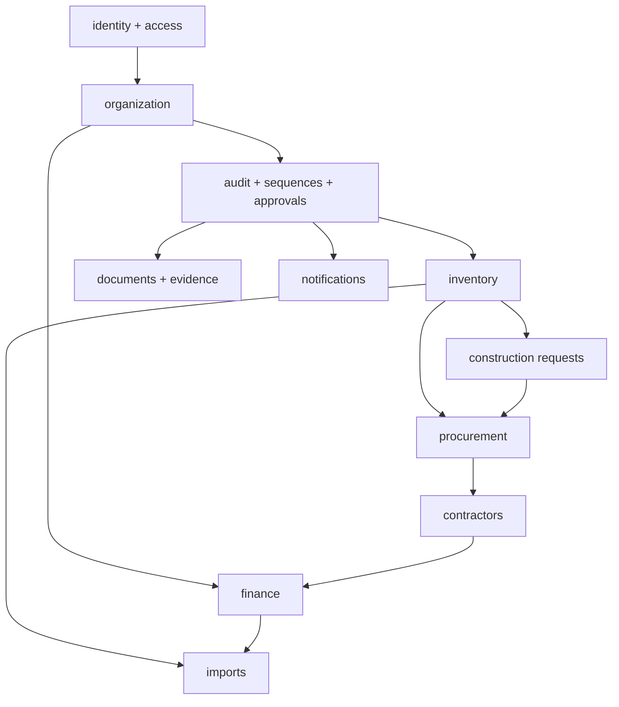

# Module registry (backend build tracker)

Update **Status** and **Backend notes** as work progresses. Detailed implementation notes live in [modules/](./modules/).

**Legend:** ✅ Done · 🚧 In progress · ⬜ Not started · 📋 Scaffold only (app registered, no domain)

**Last updated:** 2026-10-29

---

## Build order (recommended)

Source: [docs/10-implementation-planning/module-build-order.md](../../docs/10-implementation-planning/module-build-order.md)

---

## L1 — Core (`erp/core/`)

| Status | App label | Code path | Product PRD | Module notes |
|--------|-----------|-----------|-------------|--------------|
| ✅ | `core_identity` | `erp.core.identity` | [user-management](../../docs/04-erp-core/user-management/PRD.md) | [modules/core-identity.md](./modules/core-identity.md) |
| ✅ | `core_access` | `erp.core.access` | [access-control](../../docs/04-erp-core/access-control/PRD.md) | [modules/core-access.md](./modules/core-access.md) |
| ✅ | `core_organization` | `erp.core.organization` | [organization-settings](../../docs/04-erp-core/organization-settings/PRD.md) | [modules/core-organization.md](./modules/core-organization.md) |
| 🚧 | `core_approvals` | `erp.core.approvals` | [approval-workflows](../../docs/04-erp-core/approval-workflows/PRD.md) | [modules/core-approvals.md](./modules/core-approvals.md) — list API + seed |
| 📋 | `core_audit` | `erp.core.audit` | [audit-logs](../../docs/04-erp-core/audit-logs/PRD.md) | [modules/core-audit.md](./modules/core-audit.md) |
| 📋 | `core_documents` | `erp.core.documents` | [document-management](../../docs/04-erp-core/document-management/PRD.md) | [modules/core-documents.md](./modules/core-documents.md) |
| 📋 | `core_sequences` | `erp.core.sequences` | (see architecture / org PRD) | [modules/core-sequences.md](./modules/core-sequences.md) |
| 📋 | `core_imports` | `erp.core.imports` | [import-export](../../docs/04-erp-core/import-export/PRD.md) | [modules/core-imports.md](./modules/core-imports.md) |
| 📋 | `core_notifications` | `erp.core.notifications` | [notifications](../../docs/04-erp-core/notifications/PRD.md) | [modules/core-notifications.md](./modules/core-notifications.md) |

---

## L2 — Business modules (`erp/modules/`)

Enable via `.env`: `ERP_MODULES=inventory,procurement,finance,...`

| Status | App label | Code path | Product PRD | Module notes |
|--------|-----------|-----------|-------------|--------------|
| 📋 | `mod_inventory` | `erp.modules.inventory` | [inventory](../../docs/05-business-modules/inventory/PRD.md) | [modules/mod-inventory.md](./modules/mod-inventory.md) |
| 📋 | `mod_procurement` | `erp.modules.procurement` | [procurement](../../docs/05-business-modules/procurement/PRD.md) | [modules/mod-procurement.md](./modules/mod-procurement.md) |
| 📋 | `mod_finance` | `erp.modules.finance` | [finance-accounting](../../docs/05-business-modules/finance-accounting/PRD.md) | [modules/mod-finance.md](./modules/mod-finance.md) |

---

## L3 — Construction extension (`erp/extensions/construction/`)

Requires `construction` in `ERP_MODULES` (installs all three apps).

| Status | App label | Code path | Product PRD | Module notes |
|--------|-----------|-----------|-------------|--------------|
| 📋 | `ext_construction_requests` | `erp.extensions.construction.requests` | [material-requests](../../docs/06-industry-extensions/construction/material-requests/PRD.md) | [modules/ext-construction-requests.md](./modules/ext-construction-requests.md) |
| 📋 | `ext_construction_contractors` | `erp.extensions.construction.contractors` | [subcontractor-management](../../docs/06-industry-extensions/construction/subcontractor-management/PRD.md) | [modules/ext-construction-contractors.md](./modules/ext-construction-contractors.md) |
| 📋 | `ext_construction_evidence` | `erp.extensions.construction.evidence` | [gps-evidence](../../docs/06-industry-extensions/construction/gps-evidence/PRD.md) | [modules/ext-construction-evidence.md](./modules/ext-construction-evidence.md) |

**Related construction PRDs (not separate Django apps yet):** [construction README](../../docs/06-industry-extensions/construction/README.md) — BOQ, site management, billing, etc.

---

## Per-module completion checklist (copy into module notes)

When implementing, tick in the module’s markdown file:

- [ ] Models + initial migration reviewed against domain model (`docs/03-domain-model/`)
- [ ] Permissions added to `seed_rbac` (or module-specific seed)
- [ ] Selectors for list/detail with scope
- [ ] Services for writes / state transitions
- [ ] DRF serializers + views + urls
- [ ] Admin registration (if useful for ops)
- [ ] OpenAPI appears correctly under `/api/v1/docs/`
- [ ] Pytest coverage for happy path + permission denial
- [ ] `MODULE_REGISTRY.md` status updated
- [ ] `IMPLEMENTATION_RECORD.md` changelog entry

---

## Cross-cutting references

| Topic | Doc |
|-------|-----|
| API envelope & errors | [docs/01-architecture/api-architecture.md](../../docs/01-architecture/api-architecture.md) |
| AuthN / AuthZ | [docs/01-architecture/authentication-and-authorization.md](../../docs/01-architecture/authentication-and-authorization.md) |
| Domain entities | [docs/03-domain-model/](../../docs/03-domain-model/) |
| Frontend contract | [docs/01-architecture/frontend-architecture.md](../../docs/01-architecture/frontend-architecture.md) |
